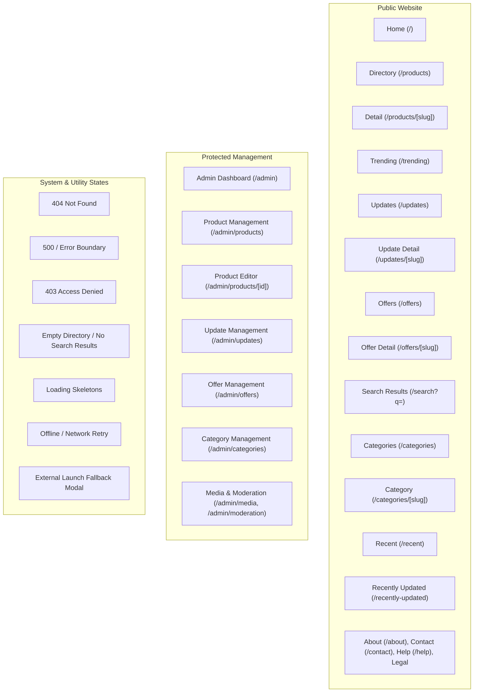

# TomeSphere — Comprehensive Page Specifications & Screen Blueprints

**Document Type:** Page Specifications & Screen Blueprints  
**Owner:** UI/UX Lead  
**Status:** Approved  
**Last Reviewed:** 2026-10-24  
**Dependencies:** `docs/03-ui-ux-design/01-design-system-and-components.md`, `docs/01-requirements/01-product-requirements-document.md`  

---

## 1. Complete Page Inventory & Route Classification

The platform architecture divides all views and routes into three distinct groups: Public Website, Protected Management, and System / Utility States.

---

## 2. Group 1: Public-Facing Pages

### 2.1 Core Discovery Pages

#### 1. Home — `/` (Priority: Launch Foundation)
- **Purpose**: Main entry point; introduces platform value, hosts prominent product search, spotlights featured applications, surfaces recent updates/offers, and routes into the ecosystem.
- **Hierarchy**:
  - Global Header & Navigation.
  - Hero Section: Eyebrow badge (*Digital Product Place*), H1 title (*Explore the TomeSphere Ecosystem*), subtitle, prominent search input, primary CTA (*Explore Products*), secondary CTA (*View Latest Updates*), and interactive SVG orbit visual.
  - Featured Products Spotlight: 3-column curated grid of core products (BookGarden, StreetCraft, CoWatch).
  - Ecosystem Pulse: Verified statistics (live applications, categories, architecture standards).
  - Highlights Bar: Latest ecosystem changelog entry and active promotions banner.
  - Footer with legal and support links.

#### 2. Product Directory — `/products` (Priority: Launch Foundation)
- **Purpose**: Searchable, filterable catalog of all published applications, developer tools, and services.
- **Hierarchy**:
  - Page Head: Eyebrow (*Digital Products & Platforms*), H1 (*Explore Products (N)*), subtitle.
  - Filter & Search Toolbar: Horizontal scrollable category pill group + text search input with debounced querying.
  - Active Filters / Sort Bar: Sort by *Newest*, *Alphabetical*, *Recently Updated*.
  - Product Cards Grid: Responsive 3-column grid (1-column on mobile).
  - Card Elements: Category badge, status dot (`Live` with green pulse), title (H3), tagline, description clamp, tags, "View Details" internal link, "Launch App" outbound button.
  - Empty State: Renders when zero products match, providing a "Reset Filters" action.

#### 3. Product Details — `/products/[slug]` (Priority: Launch Foundation)
- **Purpose**: Permanent canonical page for each product providing complete context and access.
- **Hierarchy**:
  - Sticky Breadcrumb: `Home > Products > [Product Name]`.
  - Hero Header: Product monogram/icon, H1 name, category pill, operational status badge, launch target hostname, Primary CTA ("Launch Application"), Secondary CTA ("View Documentation / Source").
  - Tabbed Content / Scannable Sections:
    - *Overview*: Problem statement, target user persona, solution summary.
    - *Features & Capabilities*: Verified feature cards with capability descriptions.
    - *Technical Specifications*: Language, framework, database, architecture pattern, repository URL.
    - *Latest Updates & Changelog*: Chronological list of product-specific releases.
    - *Active Offers*: Product-specific promotions or trial benefits.
    - *Related Ecosystem Products*: Cards for complementary tools in the catalog.
- **Fallbacks**: Invalid slug invokes Next.js `notFound()`, rendering the custom 404 page.

#### 4. Trending — `/trending` (Priority: Deeper Discovery — Phase 3)
- **Purpose**: Surfaces products experiencing measurable, verified engagement spikes or user activity.
- **Enforcement Rule**: Strictly gated behind verified telemetry (ADR-006). If verified signals are absent, the page clearly states: *"Trending metrics are computed from verified activity; telemetry collection is currently initializing."* Manual decorative rankings are forbidden.

---

### 2.2 Updates, News & Offers Pages

#### 5. Updates Feed — `/updates` (Priority: Phase 2)
- **Purpose**: Central chronological timeline of releases, new features, bug fixes, announcements, and maintenance notices across all ecosystem products.
- **Filters**: Filter by update type (`All`, `New Launch`, `Feature`, `Improvement`, `Bugfix`, `Maintenance`) and product selector.

#### 6. Update Details — `/updates/[slug]` (Priority: Phase 2)
- **Purpose**: Permanent canonical URL for a specific release note or announcement.
- **Content**: Associated product badge, publication date, version tag (e.g. `v1.2.0`), formatted markdown release notes, author/maintainer attribution, and outbound changelog links.

#### 7. Offers Directory — `/offers` (Priority: Phase 2)
- **Purpose**: Directory of verified promotions, trial access, free tiers, and partner discounts.
- **Enforcement**: Must display expiration countdown, eligibility conditions, and target destination. Expired offers are automatically excluded.

#### 8. Offer Details — `/offers/[slug]` (Priority: Phase 2)
- **Purpose**: Dedicated terms and redemption instructions for an individual promotion.

---

### 2.3 Search & Category Pages

| Page | Route | Purpose & Implementation |
| :--- | :--- | :--- |
| **Search Results** | `/search?q=...` | Dedicated shareable search page with query highlighting, product matches, and changelog matches. |
| **Category Listing** | `/categories` | Overview of all 11 product categories with product counts and descriptions. |
| **Individual Category** | `/categories/[slug]` | Deep-linkable catalog pre-filtered to a specific category (e.g. `/categories/developer-tools`). |
| **Recently Added** | `/recent` | Direct shortcut to products published in the last 90 days. |
| **Recently Updated** | `/recently-updated` | Direct shortcut to products with release notes logged in the last 30 days. |

---

### 2.4 Platform Information & Legal Pages

| Page | Route | Status | Content & Boundaries |
| :--- | :--- | :--- | :--- |
| **About** | `/about` | Verified Current State | Studio background, architecture philosophy, ecosystem vision. |
| **Contact** | `/contact` | Verified Current State | Direct message form with write-only RLS and input length validation. |
| **Help / FAQ** | `/help` | Phase 2 | Guidance on launching apps, report broken links, catalog submission questions. |
| **Guestbook** | `/guestbook` | Verified Current State | Retained with strict moderation (`pending` -> `approved`). |
| **Privacy Policy** | `/privacy` | Launch Foundation | Truthful data handling (no third-party tracking cookies, contact form retention). |
| **Terms of Use** | `/terms` | Launch Foundation | Conditions of catalog usage, outbound link disclaimer. |
| **Cookie Policy** | `/cookies` | Launch Foundation | Clarifies zero tracking cookies; theme preference stored in localStorage. |
| **Accessibility** | `/accessibility` | Launch Foundation | WCAG 2.1 AA commitments, keyboard focus notes, reporting channel. |

---

## 3. Group 2: Protected Management Pages (Admin)

All `/admin/*` routes are protected by server-side authorization middleware. They are excluded from public navigation and search engine indexing (`robots.txt: Disallow: /admin`).

| Page | Route | Administrative Capability |
| :--- | :--- | :--- |
| **Admin Dashboard** | `/admin` | Overview of total products, active offers, drafts, and recent inquiries. |
| **Product Management** | `/admin/products` | Master table with status toggle (`Draft`, `Live`, `In progress`, `Archived`). |
| **Product Editor** | `/admin/products/[id]` | Form for metadata, slug validation, URL testing, tags, and image upload. |
| **Update Management** | `/admin/updates` | Create, edit, and publish version changelogs. |
| **Offer Management** | `/admin/offers` | Create promotions, configure eligibility, and set start/end expiration dates. |
| **Category Management**| `/admin/categories`| Manage classification labels, descriptions, and icons. |
| **Moderation & Inquiries**| `/admin/moderation`| Review pending guestbook submissions and triage contact form inquiries. |

---

## 4. Group 3: System & Utility States

| State / View | Trigger / Location | Visual Presentation & Recovery Path |
| :--- | :--- | :--- |
| **404 Not Found** | `app/not-found.jsx` | Clean dark illustration, "Page Not Found", quick search bar, button linking back to `/products`. |
| **500 Server Error** | `app/error.jsx` | Error boundary catching uncaught exceptions; displays "Unexpected System Issue" with a "Try Again" trigger. |
| **403 Access Denied** | `/admin` unauthorized | "Access Restricted: Administrative credentials required." |
| **No Search Results** | Inside `/products` / `/search` | "No products match your criteria. Try adjusting keywords or resetting filters." |
| **Empty Directory** | Category with 0 products | "No products currently published under this category." |
| **Loading Skeletons**| SSR / Client loading | Translucent pulsing cards matching exact layout dimensions. |
| **External Launch Modal**| Outbound CTA click | Subtle toast or tooltip indicating: *"Opening [app-name] in a new tab on an independent domain."* |

---

## 5. Navigation Specification

### 5.1 Desktop Primary Navigation Bar (`components/Navbar.jsx`)
- **Brand Monogram & Title**: `TS` monogram + `TomeSphere` (links to `/`).
- **Tagline**: `Product Place · tomesphere.in`.
- **Primary Nav Links**:
  - `Home` (`/`)
  - `Products` (`/products`)
  - `Trending` (`/trending`)
  - `Updates` (`/updates`)
  - `Offers` (`/offers`)
  - `About` (`/about`)
- **Utility Actions**:
  - Theme Toggle Button (Sun/Moon icon for Dark/Light mode).
  - Search Trigger Button (Opens search modal or navigates to `/products`).

### 5.2 Mobile Drawer Navigation
- Slide-out translucent panel triggered via hamburger menu (`Menu` / `X` icon).
- Lists all primary nav links with large 48px touch targets.
- Prominent search input embedded directly inside the top of the mobile drawer.
- Theme switch toggle anchored at the drawer bottom.

### 5.3 Global Footer (`components/Footer.jsx`)
- Column 1: Brand statement, copyright, domain indicator.
- Column 2 (Discovery): Products, Categories, Trending, Recently Added.
- Column 3 (Ecosystem): Updates, Offers, Documentation, GitHub.
- Column 4 (Legal & Support): Contact, Help / FAQ, Privacy Policy, Terms, Cookies, Accessibility.
