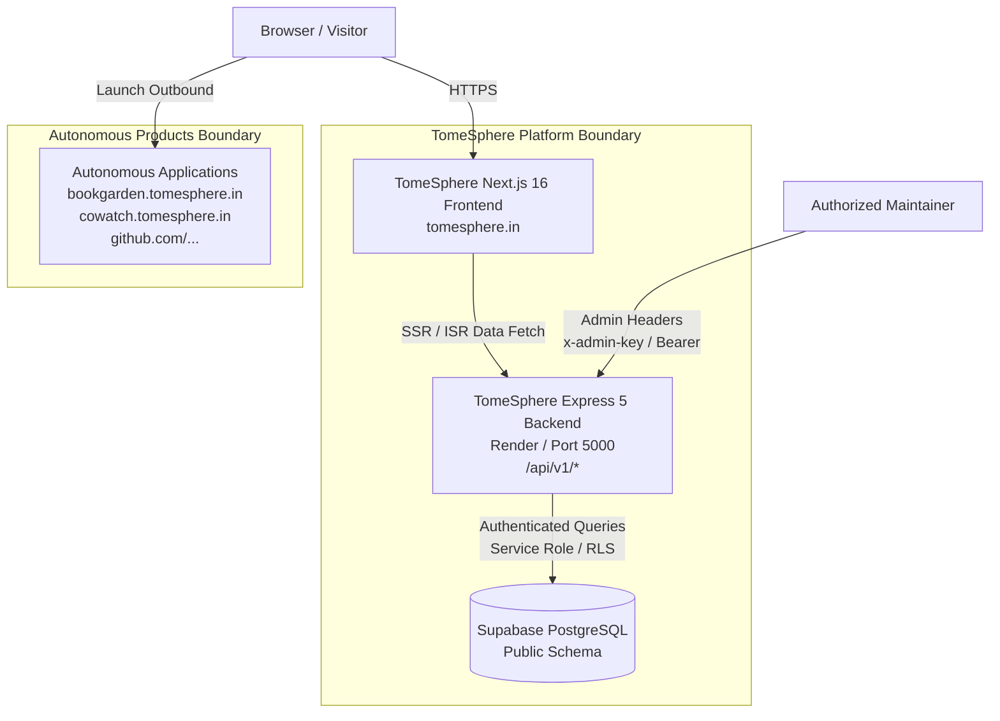

# TomeSphere — System Architecture & Product Boundaries

**Document Type:** System Architecture & Technical Specifications  
**Owner:** Systems Architect  
**Status:** Draft  
**Last Reviewed:** 2026-10-24  
**Dependencies:** `docs/01-requirements/01-product-requirements-document.md`  

---

## 1. Architectural Philosophy & Boundaries

TomeSphere operates as an **independent metadata and product discovery hub**. It does not act as a runtime execution container or database host for the applications it catalogues.

### Core Architectural Principle: Autonomy & Loose Coupling
Each product catalogued by TomeSphere (e.g. BookGarden, CoWatch, StreetCraft) is an autonomous system. Individual products retain:
- Their own source code repositories.
- Their own database schemas and data stores.
- Their own authentication, user sessions, and authorization mechanisms.
- Their own domain hosting, deployment pipelines, and scaling characteristics.

TomeSphere owns:
- Canonical product metadata (identity, descriptions, media, tags, categorization, status).
- The discovery platform (`tomesphere.in`), including search, filtering, and directory interfaces.
- Dedicated product information pages (`/products/[slug]`).
- Ecosystem announcements, release notifications, and promotional listings.
- Ecosystem-level aggregated discovery metrics.

---

## 2. System Topology & Component Layout

---

## 3. Data Ownership & Responsibility Matrix

| Data Entity | Authoritative Owner | Storage Location | TomeSphere Responsibility | Product Responsibility |
| :--- | :--- | :--- | :--- | :--- |
| **Product Metadata** (name, description, tags, slug) | TomeSphere Platform | Supabase `public.projects` | Master record; validated via `project.validator.js` | Provides verified marketing and technical copy |
| **Product Deployment URLs** | TomeSphere Catalog | Supabase `public.projects.url` | Maintains active routing targets; checks validity | Hosts live service at specified domain |
| **User Accounts & Identity** | Autonomous Applications | Independent Product DBs | **None**. TomeSphere holds zero product-level credentials | Full ownership of user registration, passwords, JWTs |
| **Application Business Data** | Autonomous Applications | Independent Product DBs | **None**. No access to private user tables or documents | Full ownership of domain transactions |
| **Announcements & Changelogs** | TomeSphere Platform | Supabase (Phase 3 schema) | Aggregates and publishes validated ecosystem releases | Submits release notes upon production deployment |
| **Public Contact & Inquiries** | TomeSphere Platform | Supabase `public.contacts` | Captures, stores, and notifies admins of platform inquiries | Handles support requests specific to app features |
| **Visitor Guestbook** | TomeSphere Platform | Supabase `public.guestbook` | Moderates and displays public platform feedback | Unrelated to product apps |

---

## 4. Subsystem Specifications

### 4.1 Frontend Tier (`app/`)
- **Framework**: Next.js 16 (App Router), React 19.
- **Styling**: Vanilla CSS (`app/globals.css`) using CSS custom properties (`--bg-primary`, `--accent-violet`, `--accent-teal`, etc.) with dark-mode first design tokens.
- **Rendering Strategy**:
  - Incremental Static Regeneration (ISR) with revalidation window (`revalidate = 1800` seconds / 30 minutes) on `/` and `/products`.
  - Client components (`HomeOverviewClient.jsx`, `WorkCatalogClient.jsx`) handle interactive client-side filtering, state, and theme switching.
- **Hosting Target**: Vercel (Production deployments only; preview deployments suppressed via `vercel.json`).

### 4.2 Backend Tier (`server/`)
- **Runtime**: Node.js ESM with Express 5.
- **Architecture**: Layered service-repository pattern:
  - `routes / server.js`: HTTP request dispatching, CORS configuration, request logging, and error handling.
  - `auth/`: Admin authentication middleware (`requireAdminMiddleware`) using constant-time timing-safe buffer comparison.
  - `validators/`: Strict payload sanitization and boundary checking (`project.validator.js`, etc.).
  - `services/`: Business orchestration layer (`project.service.js`, etc.).
  - `repositories/`: Data access layer via Supabase client (`project.repository.js`, etc.).
- **Hosting Target**: Render / Docker container / Node.js instance.

### 4.3 Database Tier (`supabase/`)
- **Engine**: PostgreSQL hosted on Supabase.
- **Security**: Mandatory Row Level Security (RLS) on all tables (`projects`, `profile`, `skills`, `guestbook`, `contacts`).
- **Extensions**: `pgcrypto` (UUID generation), `pg_trgm` (trigram search indexing).
- **Triggers**: Automated timestamp maintenance via `handle_updated_at()` trigger function with strict search path (`SET search_path = public`).

---

## 5. Three-Tier Status Classification

### 5.1 Verified Current State
- Next.js frontend connects to Express backend via `lib/api-client.js`.
- Express backend queries Supabase using `@supabase/supabase-js` client.
- Zero database credentials or admin keys exposed to browser client bundle.
- CORS configured with explicit allowed origins (`server.config.js`).
- Complete automated security test suite verifies isolation and boundaries (`tests/security.test.js`).

### 5.2 Approved Decisions
- **Slug Endpoint Contract**: Express backend must expose `GET /api/v1/projects/slug/:slug` mapped to `projectRepository.findBySlug(slug)`.
- **Frontend Detail Page Isolation**: `app/products/[slug]/page.jsx` must perform server-side data fetching directly through `apiClient.projects.getBySlug(slug)` and generate dynamic metadata without client hydration leaks.
- **Zero Monolithic Bloat**: No product-specific business logic or client SDKs (e.g. WebRTC engines, 3D try-on renderers) will be imported into the TomeSphere repository.

### 5.3 Proposals (Subject to Further Review)
- **API Gateway Rate Limiting**: Introduce Redis-backed IP rate limiting on public API endpoints (`express-rate-limit`).
- **Webhooks for Automated Catalog Ingestion**: Allow ecosystem products to trigger catalog update webhooks when a new version is tagged in GitHub.
