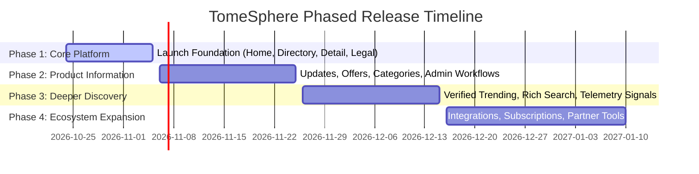

# TomeSphere — Strategic Roadmap, Phased Release Plan & Definition of Ready

**Document Type:** Strategic Roadmap & Readiness Standards  
**Owner:** Product & Engineering Leads  
**Status:** Approved  
**Last Reviewed:** 2026-10-24  
**Dependencies:** `docs/01-requirements/01-product-requirements-document.md`, `docs/03-ui-ux-design/02-page-specifications-and-journeys.md`  

---

## 1. Phased Release Plan & Milestones

The TomeSphere development lifecycle follows a disciplined 4-phase rollout to ensure the foundational discovery engine is hardened before building secondary content and telemetry systems.

---

### Phase 1 — Core Platform (Launch Foundation)
*Objective: Deliver the essential product discovery engine, canonical detail pages, and robust system hygiene.*

- **Scope & Deliverables**:
  - Global Header & Navigation (`Home`, `Products`, `Trending*`, `Updates*`, `Offers*`, `About`). *(*Trending/Updates/Offers display roadmap placeholders or launch states).*
  - Homepage (`/`) with cinematic dark hero, featured applications spotlight, and ecosystem pulse.
  - Canonical Product Directory (`/products`) with category filtering, search, and responsive cards.
  - Dedicated Product Detail Pages (`/products/[slug]`) with verified overview, features, technical specifications, and outbound launch links.
  - Platform Information: About (`/about`), Contact (`/contact`), and Guestbook (`/guestbook`).
  - Essential Legal & Trust Pages: Privacy Policy (`/privacy`), Terms of Use (`/terms`), Cookie Policy (`/cookies`), and Accessibility (`/accessibility`).
  - System & Error Pages: Custom `404 Not Found`, `500 Error Boundary`, and offline fallback banner.
  - Backend API: `GET /api/v1/projects` and `GET /api/v1/projects/slug/:slug`.
- **Exit Gate**: 100% of seeded products accessible via stable slug; zero hydration mismatches; all automated security tests passing.

---

### Phase 2 — Product Information & Publishing
*Objective: Introduce dynamic updates, promotional offers, category deep-dives, and management workflows.*

- **Scope & Deliverables**:
  - Central Updates Feed (`/updates`) and permanent Update Details (`/updates/[slug]`).
  - Offers Directory (`/offers`) and Offer Details (`/offers/[slug]`) with automated expiration handling.
  - Category Listing (`/categories`) and deep-linkable individual category pages (`/categories/[slug]`).
  - Discovery shortcuts: Recently Added (`/recent`) and Recently Updated (`/recently-updated`).
  - Protected Management Console (`/admin`): Lightweight forms for product metadata, update authoring, and offer publication with server-side authentication.
- **Exit Gate**: Updates and offers data models deployed with RLS; non-admin users blocked from `/admin/*`.

---

### Phase 3 — Deeper Discovery & Verified Intelligence
*Objective: Build trustworthy popularity signals, richer search capabilities, and analytics-driven discovery.*

- **Scope & Deliverables**:
  - Trending Hub (`/trending`) powered by authenticated event telemetry (outbound click volume over 7-day windows).
  - Rich Search (`/search?q=...`) supporting multi-attribute queries (matching products, changelogs, and tags).
  - Multi-attribute catalog sorting: *Newest*, *Alphabetical*, *Recently Updated*, *Verified Trending*.
  - Related product recommendations based on category and shared technology tags.
- **Exit Gate**: Verified telemetry pipeline operating without collecting PII; trending rankings provably grounded in real engagement.

---

### Phase 4 — Ecosystem Expansion & Personalization
*Objective: Evaluate cross-product integrations, user notifications, and community features based on verified demand.*

- **Scope & Deliverables**:
  - Product update subscriptions (RSS / Atom feeds and optional email digest).
  - Cross-product operational uptime monitoring (automated health checks of subdomains).
  - Saved products / bookmarks (local-storage first; user accounts only if multi-device sync is requested).
  - Developer documentation search & API gateway registry.
- **Exit Gate**: User accounts introduced only if authenticated state is strictly required.

---

## 2. Definition of Ready (DoR) Gate

Before any major feature or phase is approved for active code implementation, it must satisfy all 8 gates:

1. **Documented Purpose & Persona**: Must have a clear user problem defined in `docs/01-requirements/`.
2. **Approved UI Design & Breakpoints**: Complete layout specifications for mobile (320px–375px), tablet, and desktop.
3. **All Interface States Defined**: Explicit visual designs for default, hover, active, focus, loading skeleton, empty state, and error banner.
4. **Data Contract & Validation Schema**: Typed schema definition and server validator rules documented in `docs/05-data/`.
5. **Security & Permission Model**: Explicit authorization level (public read vs admin write) and RLS policy rules defined in `docs/06-security-privacy/`.
6. **Accessibility Criteria**: WCAG 2.1 AA color contrast verified, keyboard navigable, and reduced-motion compliant.
7. **Acceptance Criteria & Test Plan**: Concrete test assertions specified prior to writing application code.
8. **Rollback & Failure Strategy**: Documented fallback behavior if external services or database queries fail.
